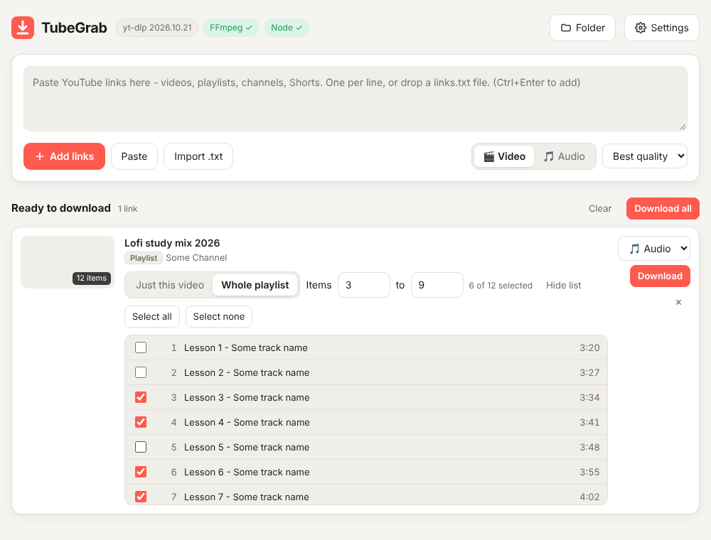

# TubeGrab

A friendly desktop app for downloading YouTube videos, playlists and music, built on [yt-dlp](https://github.com/yt-dlp/yt-dlp).
Paste links, tick what you want, press **Download checked**. No more `links.txt` + batch files.



## Download

Go to **[Releases](../../releases/latest)** and get:

- **`TubeGrab-portable-win64.zip`** (recommended): unzip anywhere and run `TubeGrab.exe`. FFmpeg and Deno are included, so there's nothing to install.
- **`TubeGrab.exe`**: just the app, if you already have FFmpeg and Deno (run `Install-Tools.bat` to get them).

Windows SmartScreen may warn about an unknown app the first time. Click **More info → Run anyway**.

## How to use

1. **Paste your links** into box 1: videos, playlists, channels or Shorts, one per line. You can also use **Paste**, or **Import .txt…** for an old `links.txt`.
2. **Format & save to**: pick *Video* (quality, MP4/MKV, subtitles) or *Audio only* (MP3, M4A, Opus, FLAC, WAV), and the folder.
3. **Choose what to download**: press **Load links** (or Ctrl+Enter) to see every video. Tick or untick items. Playlists can be expanded to pick single videos.
   - Click a link's **Format** cell (or right-click it) to download just that link as audio or video.
   - For a `watch?v=…&list=…` link only the video you opened is ticked; tick more if you want the rest.
4. Press **Download checked**. Use **Pause**, **Stop** and **Open folder** as needed.

In a hurry? Paste links and press **Download checked** straight away. They're read and downloaded in one go.

Videos are saved to `Downloads\TubeGrab`, audio to `Downloads\TubeGrab\Audio`.

### Sorting videos into folders (CSV)

Make a CSV (in Excel: *Save as → CSV*) with a link column and a folder column, and open it with **Import .txt / .csv…**:

| Link | Folder |
|---|---|
| https://www.youtube.com/watch?v=… | 1 |
| https://www.youtube.com/watch?v=… | 1 |
| https://www.youtube.com/playlist?list=… | 2 |

Everything marked `1` is saved in `Downloads\TubeGrab\1`, everything marked `2` in `Downloads\TubeGrab\2`, and so on.
Folder names can be numbers or words. Links without a folder go to the main folder. A playlist with a folder goes straight into that folder.
Audio downloads go in an `Audio` subfolder inside the folder.

- The folder column is found by its header (any header containing "folder"). Without a header, the first non-link value on each row is used.
- You can also type or paste `link, folder` lines into box 1, or copy the two columns straight from Excel.
- To change a link's folder later, click its **Folder** cell or right-click it → **Set folder…**.
- See [`docs/example-links.csv`](docs/example-links.csv).

## Settings

**Settings…** (top right) has the rest:

| Setting | What it does |
|---|---|
| Subtitle languages | e.g. `en.*,ta,hi`, optionally auto-generated subtitles too |
| Embed cover / metadata / chapters | Saved inside the file |
| Cut out sponsor segments | Removes sponsor / self-promo / "subscribe" bits via SponsorBlock |
| Playlists in their own folder, numbered files | `Playlist name/01 - Title.mp4` |
| Skip things I already downloaded | Remembers finished items (separately for video and audio); *Forget download history* resets it |
| Speed limit | e.g. `2M` so downloads don't hog the connection |
| Use cookies from | For age-restricted / members-only / "confirm you're not a bot" errors (Firefox works best) |
| Update yt-dlp | When running from source; YouTube changes often |

Errors show up in the log with a tip on how to fix them.

## Run from source

Needs Python 3.11+ with Tkinter (included in the python.org installer). Works on Windows, macOS and Linux.

```bat
Install-Tools.bat          :: once: FFmpeg + Deno (+ Python if missing) via winget
Start-TubeGrab.bat         :: installs yt-dlp on first run, then opens the window
```

Or manually: `pip install -U "yt-dlp[default]"`, then `python tubegrab.py`.
On Linux you may need your distro's Tk package (e.g. `sudo apt install python3-tk`).

Run the tests with `pip install pytest`, then `python -m pytest -q`.

## Making a new release (maintainers)

GitHub Actions builds everything on a Windows machine with the newest yt-dlp:

1. Update `CHANGELOG.md` and commit.
2. Tag and push:
   ```bat
   git tag v1.1.0
   git push origin v1.1.0
   ```
3. A few minutes later the release appears with `TubeGrab.exe` and the portable zip attached.
   The version number and repo name are stamped into the app automatically, so existing users get a "new version available" notice.

Because the .exe has yt-dlp built in, **make a new release whenever YouTube downloads start failing**. Even a release with no code changes picks up the latest yt-dlp.
To test a build without releasing, open **Actions → Build & release → Run workflow** and download the result from the run's *Artifacts*.

You can also build locally with `build-exe.bat`.

## Project layout

| File | What it is |
|---|---|
| `tubegrab.py` | The desktop window (Tkinter) |
| `tubegrab_core.py` | Everything that talks to yt-dlp: settings, reading links, downloading |
| `assets/tubegrab.ico` | App icon |
| `Start-TubeGrab.bat` / `Install-Tools.bat` / `build-exe.bat` | Windows helpers |
| `tests/` | Tests, including real local downloads |
| `.github/workflows/` | CI tests and the release build |

Settings and the download history live in `%APPDATA%\TubeGrab`.

## Credits

- [yt-dlp](https://github.com/yt-dlp/yt-dlp) does all the downloading
- [FFmpeg](https://ffmpeg.org) (builds from [yt-dlp/FFmpeg-Builds](https://github.com/yt-dlp/FFmpeg-Builds)) and [Deno](https://deno.com) are bundled in the portable zip under their own licenses
- Started from the *Bulk YouTube Downloader* batch script by [EDM115](https://github.com/EDM115)

Only download content you have the right to download.
