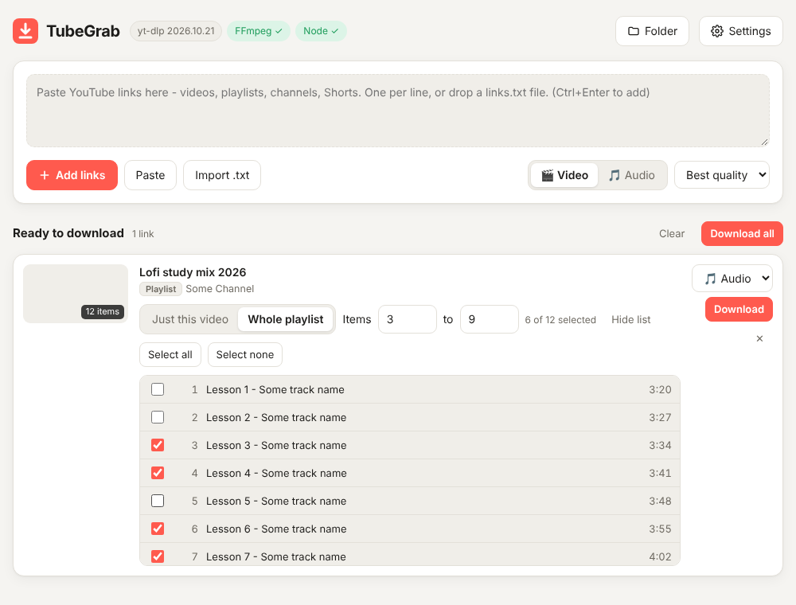

# TubeGrab

A friendly Windows app for downloading YouTube videos, playlists and music, built on [yt-dlp](https://github.com/yt-dlp/yt-dlp).
Paste links, press **Download**, done. No more `links.txt` + batch files.



It runs on your own PC and opens in your browser at `http://127.0.0.1:8765`. Nothing is uploaded anywhere,
and other devices or websites can't control it.

## Download

Go to **[Releases](../../releases/latest)** and get:

- **`TubeGrab-portable-win64.zip`** (recommended): unzip anywhere and run `TubeGrab.exe`. FFmpeg and Deno are included, so there's nothing to install.
- **`TubeGrab.exe`**: just the app, if you already have FFmpeg and Deno (run `Install-Tools.bat` to get them).

Windows SmartScreen may warn about an unknown app the first time. Click **More info → Run anyway**.

Keep the black console window open while downloading. Closing it (or **Settings → Quit**) stops TubeGrab.

## Features

- **Download** button (or Ctrl+Enter), plus **Paste**, **Import .txt** and drag-and-drop
- 🎬 Video (best, 4K … 360p; MP4 or MKV) or 🎵 Audio (MP3, M4A, Opus, FLAC, WAV)
- Playlists: choose a range or tick individual items; "just this video" for `watch?v=…&list=…` links
- Live progress, speed, ETA, cancel / retry, several downloads at once
- Subtitles (any languages), cover art, metadata and chapters embedded
- Cuts out sponsor segments with SponsorBlock (optional)
- Skips things you already downloaded
- Uses your browser's cookies for age-restricted / "confirm you're not a bot" videos
- Plain-English hints when something goes wrong, and a notice when a new TubeGrab version is out

Videos are saved to `Downloads\TubeGrab`, audio to `Downloads\TubeGrab\Audio` (changeable in Settings).

## Run from source

Needs Python 3.11+.

```bat
Install-Tools.bat          :: once: FFmpeg + Deno (+ Python if missing) via winget
Start-TubeGrab.bat         :: installs yt-dlp on first run, then starts the app
```

Or manually: `pip install -U "yt-dlp[default]"`, then `python tubegrab.py`.
Running from source lets you use **Settings → Update yt-dlp** whenever YouTube changes something.

Run the tests with `pip install pytest` and then `python -m pytest -q`.

## Making a new release (maintainers)

GitHub Actions builds everything on a Windows machine with the newest yt-dlp:

1. Update `CHANGELOG.md` and commit.
2. Tag and push:
   ```bat
   git tag v1.1.0
   git push origin v1.1.0
   ```
3. A few minutes later the release appears with `TubeGrab.exe` and the portable zip attached.
   The version number and repo name are stamped into the app automatically, so existing users get the "new version available" banner.

Because the .exe has yt-dlp built in, **make a new release whenever YouTube downloads start failing**. Even a release with no code changes picks up the latest yt-dlp.
To test a build without releasing, open **Actions → Build & release → Run workflow** and download the result from the run's *Artifacts*.

You can also build locally with `build-exe.bat`.

## Project layout

| File | What it is |
|---|---|
| `tubegrab.py` | The app: yt-dlp + a small local web server |
| `ui.html` | The interface |
| `Start-TubeGrab.bat` / `Install-Tools.bat` / `build-exe.bat` | Windows helpers |
| `tests/` | Smoke tests (option checks + a real local download) |
| `.github/workflows/` | CI tests and the release build |

Settings and the "already downloaded" lists live in `%APPDATA%\TubeGrab`.

## Credits

- [yt-dlp](https://github.com/yt-dlp/yt-dlp) does all the downloading
- [FFmpeg](https://ffmpeg.org) (builds from [yt-dlp/FFmpeg-Builds](https://github.com/yt-dlp/FFmpeg-Builds)) and [Deno](https://deno.com) are bundled in the portable zip under their own licenses
- Started from the *Bulk YouTube Downloader* batch script by [EDM115](https://github.com/EDM115)

Only download content you have the right to download.
